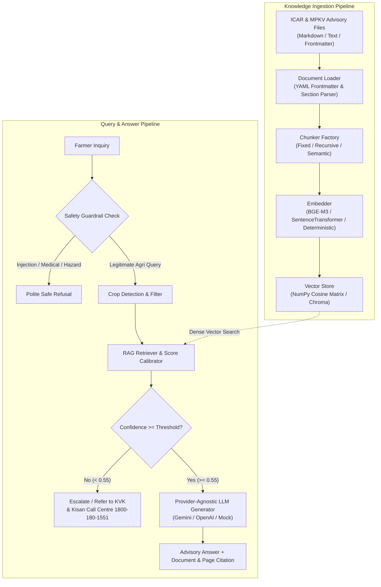

# KisanSathi Phase 1 Architecture Documentation

## 1. Overview
KisanSathi is a multilingual, voice-first agricultural advisory system designed for Indian farmers. Phase 1 establishes the core monorepo structure, data ingestion engine, multi-strategy chunking pipeline, provider-agnostic vector retrieval, safety guardrail layer, and a 100-question evaluation benchmark suite.

## 2. Ingestion & Metadata Schema
Every chunk indexed in KisanSathi retains the following metadata:
- `document_id`: Standardized institutional identifier (e.g. `ICAR-IIHR-TOM-2024`, `MPKV-ONION-PKG-2024`)
- `document_name`: Official human-readable advisory title
- `crop`: Target crop (`tomato`, `onion`, `soybean`, `cotton`)
- `state`: Target geographical boundary (`Maharashtra`)
- `page_number`: Document page or section number (e.g. `Page 2`, `Page 3`)
- `section_title`: Specific topic (e.g. `Section 3: Major Diseases and Management`)
- `trust_level`: Institutional trust ranking (`official_icar`, `state_agri_university`, `kvk`)
- `strategy`: Chunking strategy used (`fixed`, `recursive`, `semantic`)

## 3. Chunking Strategies Compared
1. **FixedChunker**: Slices text strictly by character length with fixed sliding overlap. Often divides chemical recommendations or active ingredient ratios across chunks.
2. **RecursiveChunker**: Uses hierarchical delimiters (`\n\n`, `\n`, `. `, ` `) to prioritize paragraph and sentence integrity.
3. **SemanticChunker**: Groups content into topical units (disease symptoms + control measures) while attaching contextual document headers to each chunk.

## 4. Safety Guardrails & "I Don't Know" Handling
- **Prompt Injection Defense**: Regex filters intercept adversarial prefix injection attempts (`ignore previous instructions`, `system override`, `prescribe 100x`).
- **Medical & Legal Refusals**: Clarifies system scope and declines human health prescriptions and legal drafting.
- **Pesticide Caution Enforcement**: Intercepts queries seeking to spray hazardous pesticides without masks or mixing incompatible chemicals.
- **Calibrated 'I Don't Know'**: Any query with retrieval confidence below 0.55 or referring to unsupported states/crops is declined gracefully and redirected to the Kisan Call Centre at `1800-180-1551`.
